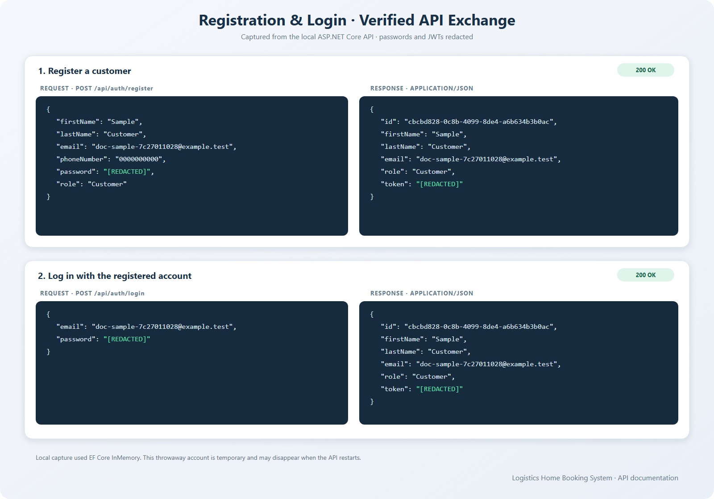

# API documentation

## Authentication

- POST /api/auth/register
- POST /api/auth/login
- GET /api/auth/me

### Verified registration and login exchange

The following request/response pair was captured from the local API using a generated throwaway account. Both calls returned **200 OK**. The password and JWT are redacted; the account ID and sample email are from the actual responses. The local capture used `http://127.0.0.1:5501`; use the host and port configured for your own run.

**Registration request**

```http
POST /api/auth/register HTTP/1.1
Host: 127.0.0.1:5501
Content-Type: application/json

{
  "firstName": "Sample",
  "lastName": "Customer",
  "email": "doc-sample-7c27011028@example.test",
  "phoneNumber": "0000000000",
  "password": "[REDACTED]",
  "role": "Customer"
}
```

**Registration response — 200 OK**

```json
{
  "id": "cbcbd828-0c8b-4099-8de4-a6b634b3b0ac",
  "firstName": "Sample",
  "lastName": "Customer",
  "email": "doc-sample-7c27011028@example.test",
  "role": "Customer",
  "token": "[REDACTED]"
}
```

**Login request**

```http
POST /api/auth/login HTTP/1.1
Host: 127.0.0.1:5501
Content-Type: application/json

{
  "email": "doc-sample-7c27011028@example.test",
  "password": "[REDACTED]"
}
```

**Login response — 200 OK**

```json
{
  "id": "cbcbd828-0c8b-4099-8de4-a6b634b3b0ac",
  "firstName": "Sample",
  "lastName": "Customer",
  "email": "doc-sample-7c27011028@example.test",
  "role": "Customer",
  "token": "[REDACTED]"
}
```

The screenshot below presents the same verified exchange. The account was created in the local EF Core InMemory database, so it is temporary and may no longer exist after the API process restarts.



## Bookings

- POST /api/bookings/estimate
- GET /api/bookings/vehicles
- GET /api/bookings
- GET /api/bookings/me
- POST /api/bookings
- PATCH /api/bookings/{id}/status

## Admin

- GET /api/admin/dashboard
- GET /api/admin/vehicles
- POST /api/admin/vehicles
- GET /api/admin/drivers
- POST /api/admin/drivers
- GET /api/admin/pricing
- POST /api/admin/pricing

Swagger is enabled in development and documents the endpoints and JWT bearer support.
