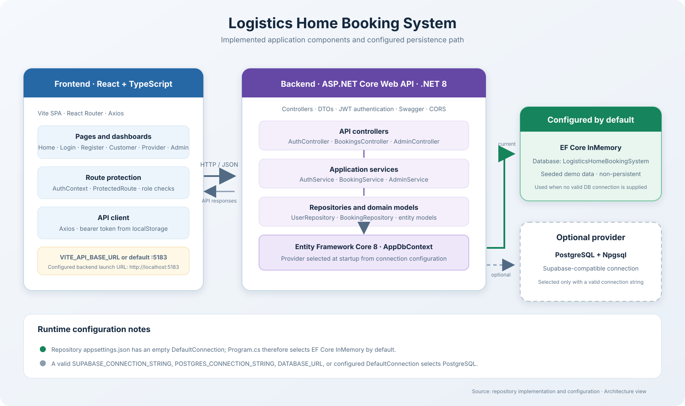

# Architecture

The system follows a layered design aligned with the internship requirements.

## Presentation layer

- React + TypeScript SPA
- Route-based pages for public, customer, provider, and admin flows
- Centralized API client and JWT token handling

## Application layer

- ASP.NET Core Web API controllers
- DTOs for request and response payloads
- Service layer implementing booking, auth, and admin logic

## Persistence layer

- EF Core DbContext
- PostgreSQL provider for Supabase deployments
- In-memory fallback for local development without a configured database

## Security

- JWT bearer authentication
- Password hashing with BCrypt
- Role-based authorization for Customer, LogisticsProvider, Driver, and Admin

## Assumptions

- Customer and provider/admin workflows are modeled through one backend API and its core modules.
- Pricing is calculated by a dedicated pricing estimate function instead of hardcoded controller logic.

## Implemented component and persistence diagram

The diagram below reflects the repository's configured default: `ConnectionStrings:DefaultConnection` is empty, so `Program.cs` selects EF Core InMemory. PostgreSQL through Npgsql is selected only when a valid connection string is supplied. The InMemory database is seeded at startup and is not persistent across process restarts.

PNG screenshot: [system-architecture-screenshot.png](assets/system-architecture-screenshot.png).
