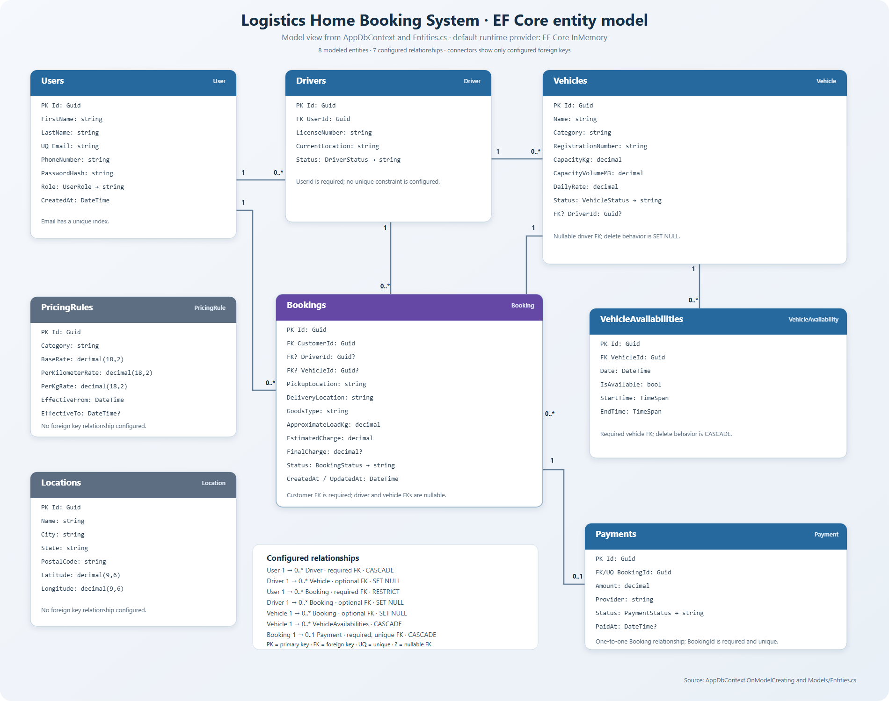

# Database design

## Implemented EF Core model

The diagram below is drawn from `backend/LogisticsHomeBookingSystem.Api/Models/Entities.cs`, the `DbSet` declarations, and relationship configuration in `Data/AppDbContext.cs`. It contains only the eight entities and seven foreign-key relationships configured by the EF Core model. `Location` and `PricingRule` have no configured foreign-key relationships, so they are shown as standalone entities.

Editable vector source: [ef-core-model.svg](assets/ef-core-model.svg).

The current default application configuration uses EF Core InMemory because `ConnectionStrings:DefaultConnection` is empty. The diagram describes the EF Core entity model, not a live PostgreSQL administration-tool screenshot.

## Configured relationships

| Principal | Dependent | Foreign key | Cardinality | Delete behavior |
|---|---|---|---|---|
| User | Driver | `Driver.UserId` (required) | One user to zero or many drivers | Cascade |
| Driver | Vehicle | `Vehicle.DriverId` (nullable) | One driver to zero or many vehicles; each vehicle has zero or one driver | Set null |
| User | Booking (customer) | `Booking.CustomerId` (required) | One user to zero or many bookings | Restrict |
| Driver | Booking | `Booking.DriverId` (nullable) | One driver to zero or many bookings; each booking has zero or one driver | Set null |
| Vehicle | Booking | `Booking.VehicleId` (nullable) | One vehicle to zero or many bookings; each booking has zero or one vehicle | Set null |
| Vehicle | VehicleAvailability | `VehicleAvailability.VehicleId` (required) | One vehicle to zero or many availability rows | Cascade |
| Booking | Payment | `Payment.BookingId` (required and unique) | One booking to zero or one payment | Cascade |

The model gives `User.Email` a unique index. Driver `UserId` is required but is not configured as unique, so the EF model does not enforce a one-to-one User/Driver relationship. Enum properties for user role and the booking, vehicle, driver, and payment statuses are configured for string storage in EF Core.

## Entity summary

- **User** — identity, contact details, password hash, role, and creation time.
- **Driver** — user foreign key, license number, current location, and status.
- **Vehicle** — vehicle identity, category, registration, capacities, rate, status, and optional driver foreign key.
- **VehicleAvailability** — vehicle foreign key, date, availability flag, and time window.
- **Location** — name, city, state, postal code, latitude, and longitude. No FK is configured in the current model.
- **Booking** — required customer FK, optional driver and vehicle FKs, pickup/delivery text, goods and load details, charges, status, and timestamps.
- **PricingRule** — category, base/per-kilometer/per-kilogram rates, and effective dates. No FK is configured in the current model.
- **Payment** — required unique booking FK, amount, provider, status, and optional paid time.

## Difference from the manual SQL schema

`database/01_schema.sql` is a separate, partial schema script and does not fully match the EF Core model shown above:

- It does not create `Locations` or `VehicleAvailability` tables.
- It adds a `CreatedAt` column to `Drivers`, which is not a property of the EF `Driver` entity.
- It defines `Payments.BookingId` as a foreign key but does not declare it unique, unlike the one-to-one EF relationship.
- It allows null for `Users.PhoneNumber`, `Drivers.CurrentLocation`, and `Vehicles.CapacityVolumeM3`, while the corresponding EF model properties are non-nullable.
- The seed script uses unquoted snake_case column names, whereas the schema script creates quoted PascalCase column names.

These differences are documented so the diagram is not mistaken for a representation of every SQL script. Review and align the manual SQL schema before using it as the PostgreSQL production schema.

## Persistence

`Program.cs` selects PostgreSQL through Npgsql when a valid connection string is configured. Otherwise, it selects EF Core InMemory. InMemory records do not persist across backend restarts. The SQL scripts are not automatically applied to the InMemory provider.
